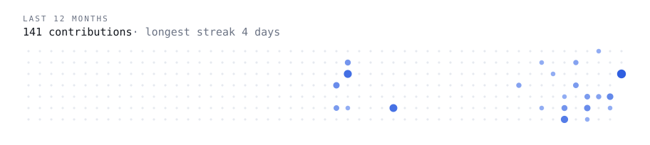

### Turn hours of manual work into systems that run on their own.

Software engineer at IBM, working on AI agent orchestration. Backend by trade: Java, Spring, Kafka, and lately LLM agents, RAG and tracing. On the side I automate my own life and build small tools, and now bring the same automation to people and businesses.

**Selected work**

- [**crumbclear**](https://github.com/Sentimenta1ist/crumbclear) — Chrome extension that deletes a site's cookies when you close its tab. Tested, Manifest V3.
- [**vocab**](https://github.com/Sentimenta1ist/vocab) — English vocabulary trainer: Gemini writes the cards, SM-2 decides when you see them again.
- [**transcribator**](https://github.com/Sentimenta1ist/transcribator) — YouTube link in, transcript and a ready LLM prompt out. Decide in 30 seconds if a video is worth an hour.
- [**memoir**](https://github.com/Sentimenta1ist/memoir) — Evening journal as a PWA: three short blocks a day, photos, FastAPI + React.
- [**x-viral-radar**](https://github.com/Sentimenta1ist/x-viral-radar) — Scores posts in your X feed by how likely they are to take off, while you scroll.
- [**diet-dash**](https://github.com/Sentimenta1ist/diet-dash) — Web app for nutritionists from my closed startup: profiles, meal plans, 9.9k products, export.

Older code, written before AI coding assistants, is kept as-is under the [`pre-ai`](https://github.com/Sentimenta1ist?tab=repositories&q=topic%3Apre-ai) topic: an x86 assembler, a SIGNAL compiler, OS simulations in Java, Lisp, numerical methods.

<!--brain-stats:start-->
**Last 7 days in my second brain:** 66 commits · 6 active days · 95 notes updated · 90 logged events · 21 posts published
Counted daily by a GitHub Action from a private repo. Numbers only. Updated 2026-10-27.
<!--brain-stats:end-->

**Stack:** Java · Spring Boot · Kafka · Python · FastAPI · TypeScript · React · PostgreSQL · Docker · LLM agents · RAG · OpenTelemetry

**Elsewhere:** [LinkedIn](https://www.linkedin.com/in/alexander-ivanenko) · [X @sentimentGod](https://x.com/sentimentGod)

<picture>
  <source media="(prefers-color-scheme: dark)" srcset="assets/dots-dark.svg" />
  
</picture>
