Software engineer at IBM, working on AI agent orchestration. Backend by trade: Java, Spring, Kafka, and lately LLM agents, RAG and tracing. On the side I automate my own life and build small tools.

### Projects

- [**crumbclear**](https://github.com/Sentimenta1ist/crumbclear) — Chrome extension that deletes a site's cookies the moment you close its tab. Manifest V3.
- [**vocab**](https://github.com/Sentimenta1ist/vocab) — English vocabulary trainer: Gemini writes the cards, SM-2 decides when you see them again.
- [**transcribator**](https://github.com/Sentimenta1ist/transcribator) — YouTube link in, transcript and a ready LLM prompt out. Decide in 30 seconds.
- [**memoir**](https://github.com/Sentimenta1ist/memoir) — Evening journal as a PWA: three short blocks a day with photos. FastAPI + React.
- [**x-viral-radar**](https://github.com/Sentimenta1ist/x-viral-radar) — Scores posts in your X feed by how likely they are to take off, while you scroll.
- [**x-scout**](https://github.com/Sentimenta1ist/x-scout) — Daily X briefing for up to 5 topics, ranked by Claude. Runs locally in a real browser.

Older code: an x86 assembler, a SIGNAL compiler, OS simulations in Java, Lisp, numerical methods.

[LinkedIn](https://www.linkedin.com/in/alexander-ivanenko) · [X @sentimentGod](https://x.com/sentimentGod) · [sentimenta1ist.github.io](https://sentimenta1ist.github.io)
