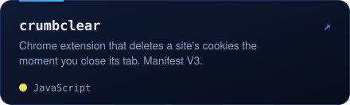
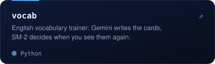
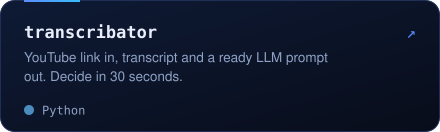
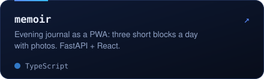
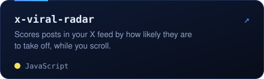
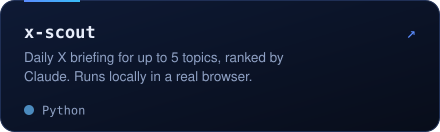
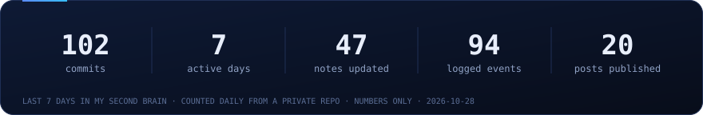
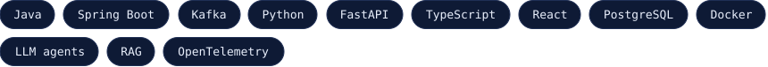
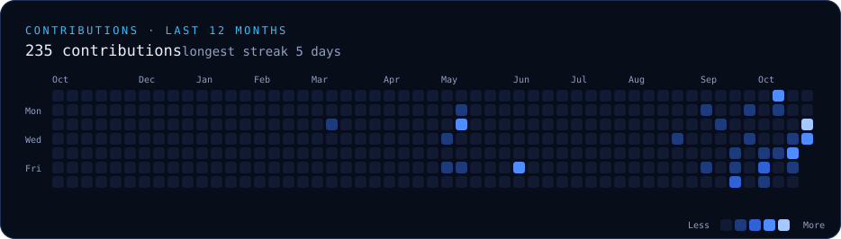

Software engineer at IBM, working on AI agent orchestration. Backend by trade: Java, Spring, Kafka, and lately LLM agents, RAG and tracing. On the side I automate my own life and build small tools, and now bring the same automation to people and businesses.

### Selected work

<table>
<tr><td width="50%"></td><td width="50%"></td></tr>
<tr><td width="50%"></td><td width="50%"></td></tr>
<tr><td width="50%"></td><td width="50%"></td></tr>
</table>

Older code topics: an x86 assembler, a SIGNAL compiler, OS simulations in Java, Lisp, numerical methods.

### Stack

### Elsewhere

